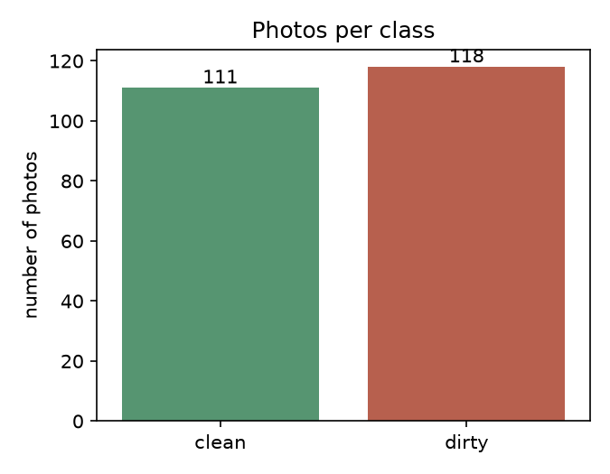
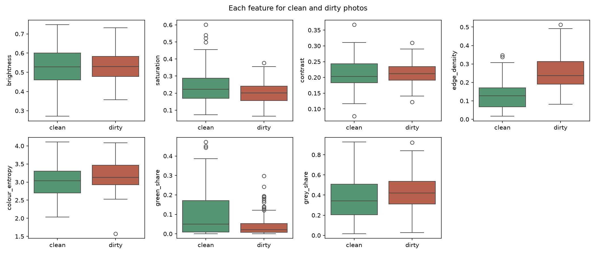
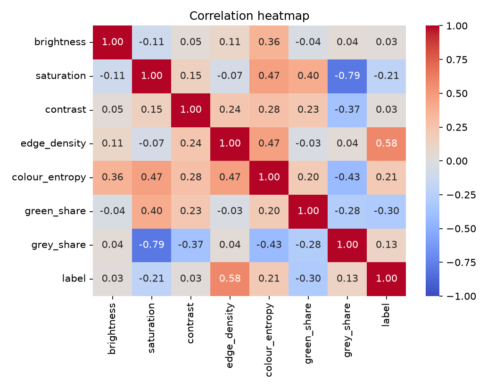
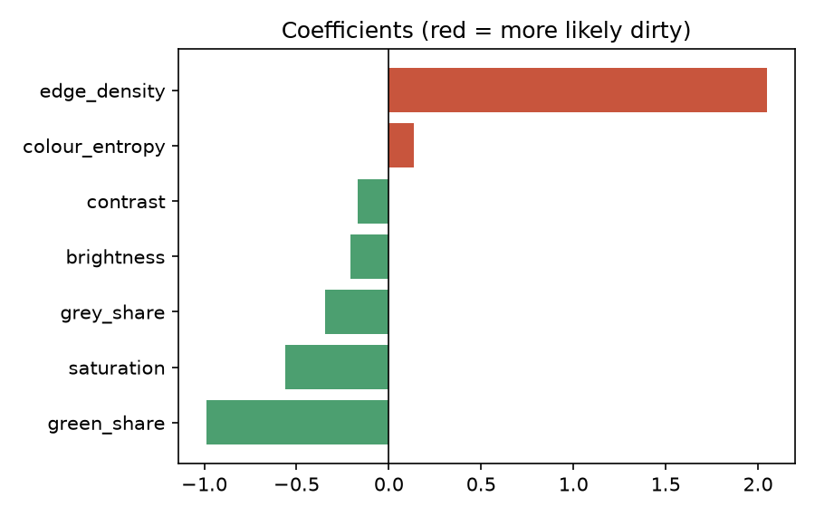
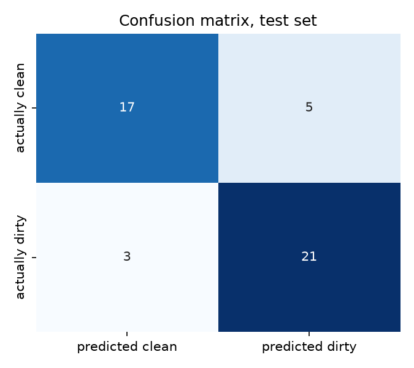

# Machine Learning Activity: Logistic Regression on Clean vs Dirty Street Photos

Group report. Due: November 9.

> **Draft status.** I drafted the answers below from the real results of `karela_clean_vs_dirty.ipynb`. Read every answer, make sure you understand it, and rewrite it in your own words before you submit. The activity says answers must be in your own words and you must be able to explain every line of code. Your own typed answers (1.1, 1.4, 1.5) are kept as you wrote them. Delete this box before submitting.

## Group members and roles

| Member | Role |
| --- | --- |
| Randel Serafica | (fill in) |
| Trishia Joy Rirao | (fill in) |

---

## Part 1: Research the dataset and its topic

**1.1 What is the name of your dataset, where did you get it, and who collected it?**

The dataset is **Clean/Littered Road Classification** on Kaggle: https://www.kaggle.com/datasets/faizalkarim/cleandirty-road-classification

It was published by Md Faizal Karim and Krishnav Rajbangshi. The page describes it as "Classify roads if clean or littered." The file we downloaded (`archive.zip`) has 237 photos and a file `metadata.csv` with two columns, `filename` and `label`. The licence on the Kaggle page is CC0 (Public Domain): https://creativecommons.org/publicdomain/zero/1.0/. This means the uploaders gave up their rights, but the page does not say where the photos came from or who took them.

**1.2 What real-world problem does this dataset help answer? Why does it matter?**

It helps identify streets with uncollected garbage from a photo. That matters because rubbish left on roads, sidewalks and canals is a health and flooding risk, and it is also against the law in the Philippines: Republic Act 9003 (Ecological Solid Waste Management Act of 2000) prohibits "littering, throwing, dumping of waste matters in public places, such as roads, sidewalks, canals" (Section 48) and sets a fine of P300 to P1,000 or community service (Section 49). The same law says local governments are responsible for enforcing it and that segregation and collection happen at the barangay level (Section 10). Barangays cannot inspect every street by hand.

This connects to our app Karela. Its civic engine lets residents report uncleaned places with a photo. If a model can make a first guess about whether a photo shows a clean or dirty area, then people do not have to check every photo by hand, and the real attention goes to the photos the model flags. Our model is a very small first test of that idea.

**1.3 Find at least two outside sources about your topic. What do they say are the main factors that affect street cleanliness (or how cleanliness is judged from images)?**

1. Sukel, M. M., Rudinac, S., and Worring, M. (2023). *GIGO, Garbage In, Garbage Out: An Urban Garbage Classification Dataset.* MultiMedia Modeling (MMM 2023), Springer LNCS vol. 13833. https://pure.uva.nl/ws/files/294580028/978-3-031-27077-2_41.pdf
   - The authors collected about 25,000 street photos in Amsterdam from phones mounted on a service vehicle. Experts defined five labels: garbage present (or none when the street is clean), garbage bags, cardboard, bulky waste and litter. They say the garbage types are visually very different in size, material and appearance, the backgrounds are noisy and the lighting varies, and their best model scored only 0.47 mAP. So judging cleanliness from images is hard even for strong models, and it is judged by the presence and the type of garbage.
2. EPFL (2017, 17 November). *Objectively measuring how clean our cities are.* https://actu.epfl.ch/news/objectively-measuring-how-clean-our-cities-are
   - EPFL researchers put cameras on street sweepers and bicycles. Software finds each object, decides if it is waste and sorts it into 25 categories such as plastic bottles, newspaper, cigarette butts and leaves. The result gives the amount, the type and the location of waste, and also how dangerous it is (glass shards are worse than chewing gum) and where it is (a park where children play counts differently). So cleanliness depends on how much waste there is, what kind, where, and how risky it is.
3. Republic Act No. 9003, *Ecological Solid Waste Management Act of 2000*, Sections 10, 48 and 49. https://apidb.denr.gov.ph/infores/uploads/policy/2001/Ref_Act_9003.pdf
   - It says what counts as littering in public places and who must collect and enforce, as described in 1.2.

**1.4 Based on your research, which features do you predict will matter most? Write your hypothesis now, before running any model.**

We expect busy, cluttered, colourful scenes (high edge density and colour variety) to be dirty, and smooth grey roads to be clean.

**1.5 What are the possible risks or ethical concerns of using this data or these predictions?**

- **Privacy.** Street photos can show faces and vehicle plate numbers. If Karela used real resident photos, they would need consent, and faces and plates would need to be blurred or removed.
- **Where the photos came from.** Many of these photos look like they were taken in another country, so a model trained on them may not work on Philippine streets. We also do not know if the photos were collected with permission. The dataset is marked CC0, but that does not prove the uploaders had the rights to the original photos.
- **Unfair labels.** A model could wrongly flag a poor neighbourhood as "dirty" just because its streets are busier, which could lead to unfair treatment or fines.
- **Natural material.** Fallen leaves or natural debris might be called trash.
- **Over-trust.** If people accept the model's answer without a human check, the mistakes fall on residents and on city staff.

---

## Part 2: Understand and prepare the data

**2.1 How many rows and columns does the dataset have? Describe what each column means.**

The original file has **237 rows** (one per photo) and **2 columns**. We added 7 numbers measured from each photo, and kept the original image size only for checking. Each photo was shrunk to 256 x 192 pixels before measuring so that every photo is measured the same way.

| Column | Meaning | Type |
| --- | --- | --- |
| filename | Name of the photo file | text |
| label | 0 = clean, 1 = dirty | target (yes/no) |
| brightness | Average brightness, 0 (dark) to 1 (bright) | number |
| saturation | Average colour strength, 0 (grey) to 1 (vivid) | number |
| contrast | Spread of grey levels in the photo | number |
| edge_density | Share of pixels on a sharp edge (a measure of clutter and detail) | number |
| colour_entropy | How many different colours are mixed (higher means more variety) | number |
| green_share | Share of green pixels (trees, grass) | number |
| grey_share | Share of grey pixels (road, concrete) | number |

After cleaning, the dataset has 229 rows (see 2.3).

**2.2 Which column is your target, and which model did you choose? Why does this model fit this target?**

The target is `label` (1 = dirty, 0 = clean). We chose **Logistic Regression**. The target has only two possible answers, yes or no, so we need a model that outputs a probability between 0 and 1 and then a yes/no decision. Linear Regression predicts any number and could give answers below 0 or above 1, which makes no sense for a yes/no outcome. The labels were already yes/no, so we did not need to convert anything.

**2.3 Are there missing values, duplicates or strange values (outliers)? How did you handle each one, and why?**

- **Missing values:** none. All 237 labels were present and every listed file was found.
- **Duplicates:** 6 files were exact copies of another file, and 8 photos in total were repeats of another photo (same picture pattern, which includes those 6). We removed the 8 repeats, which left **229 photos (111 clean, 118 dirty)**. We did this so that the same picture cannot be in both the training and the testing set, which would make the test score look better than it is.
- **Outliers:** 12 photos had at least one feature more than 3 standard deviations from the average (for example saturation, green share). We kept them because they are real photos, such as a very green street, and not mistakes. We scale all features before fitting so one extreme value does not dominate.
- **Image sizes:** the photos range from 275 x 178 to 5184 x 3625 pixels, so they come from many different sources. We do not use size as a feature (see 4.8 for the check).

**2.4 Which features are categorical? How did you convert them into numbers?**

None. All seven features are already numbers we measured from the photos, so no conversion was needed. If we had a category (for example the city), we would turn it into 0/1 columns with one-hot encoding.

**2.5 Show at least three visualizations. What pattern does each one show?**

**Chart 1: photos per class.**

After removing repeats there are 111 clean and 118 dirty photos. The two classes are almost the same size.

**Chart 2: each feature for clean and dirty photos.**

The clearest difference is `edge_density`: dirty photos have much higher values than clean ones (the middle of the dirty box is about double the clean one). Dirty photos also have a lower `green_share` and a slightly lower `saturation`. `brightness` and `contrast` look almost the same in both groups, so they should not help much.

**Chart 3: correlation heatmap.**

`edge_density` has the strongest link with dirty (0.58). `green_share` is next (-0.30), then `colour_entropy` (0.21), `saturation` (-0.21), `grey_share` (0.13), and `brightness` and `contrast` are almost zero (0.03).

**2.6 Which features are strongly related to the target? Are any features strongly related to each other? Why could that be a problem?**

`edge_density` is strongly related to the target (0.58), and `green_share` moderately (-0.30, more green means cleaner). Among the features, `saturation` and `grey_share` are strongly related to each other (-0.79), which makes sense because grey pixels have almost no colour. Other pairs are moderate, for example `colour_entropy` with `saturation` (0.47) and with `edge_density` (0.47). When two features move together, the model cannot tell which one is responsible, so their coefficients become unstable and hard to explain (multicollinearity). We test this in 4.10.

**2.7 Describe your target's distribution. How balanced are the two classes?**

In the original file, 113 photos are clean (47.7%) and 124 are dirty (52.3%). After removing the repeats, 111 are clean (48.5%) and 118 are dirty (51.5%). The classes are close to balanced. This matters because with balanced classes, accuracy is not misleading by itself, and a model that always guesses "dirty" would be right only 51.5% of the time. So any score well above 51.5% shows the model learned something.

---

## Part 4: Logistic Regression (predicting a category)

We used an 80/20 split (183 training photos, 46 testing photos), kept the clean/dirty mix the same in both, and fixed the random seed (42) so the results can be repeated. Features were scaled before fitting.

**4.1 State the problem in one sentence.**

We use brightness, colour and edge measurements from a street photo to predict whether the street in the photo is dirty.

**4.2 Why can we not use Linear Regression for this target? What does the sigmoid function do, and what does the model's output represent?**

Linear Regression draws a straight line and can output any number, including values below 0 or above 1, but our answer can only be 0 (clean) or 1 (dirty). Logistic Regression first makes a straight-line score, then passes it through the sigmoid function, an S-shaped curve that squeezes any score into a number between 0 and 1. That number is the model's estimated probability that the photo is dirty. For example 0.9 means "very likely dirty" and 0.1 means "very likely clean".

**4.3 What threshold did you use? What happens if you raise or lower it?**

We used the default threshold of 0.5: if the probability of "dirty" is at least 0.5, we predict dirty. We also tried 0.3 and 0.7 on the test set:

| Threshold | Clean called dirty (FP) | Dirty called clean (FN) | Accuracy | Precision | Recall | F1 |
| --- | --- | --- | --- | --- | --- | --- |
| 0.3 | 8 | 1 | 0.804 | 0.742 | 0.958 | 0.836 |
| 0.5 | 5 | 3 | 0.826 | 0.808 | 0.875 | 0.840 |
| 0.7 | 2 | 7 | 0.804 | 0.895 | 0.708 | 0.791 |

Lowering the threshold makes the model call more photos dirty: it catches almost every dirty street (recall 0.958) but wrongly flags more clean ones. Raising it does the opposite: fewer false alarms but it misses more dirty streets (7 missed at 0.7).

**4.4 Report the model's coefficients. Choose two and explain what each one means.**

The intercept is 0.164. Features were scaled, so each coefficient is for a one standard deviation increase, with the other features held constant. The odds ratio is the coefficient put back on the odds scale (above 1 means more likely dirty).

| Feature | Coefficient | Odds ratio |
| --- | --- | --- |
| edge_density | 2.047 | 7.74 |
| green_share | -0.988 | 0.37 |
| saturation | -0.563 | 0.57 |
| grey_share | -0.344 | 0.71 |
| brightness | -0.210 | 0.81 |
| contrast | -0.167 | 0.85 |
| colour_entropy | 0.137 | 1.15 |

- **edge_density (2.047):** when edge density goes up by one standard deviation, the odds that the photo is dirty are about 7.7 times higher, with the other features held constant. A busy scene full of small edges (piles of rubbish) points strongly to dirty.
- **green_share (-0.988):** when the share of green goes up by one standard deviation, the odds of dirty fall to about 0.37 of what they were, so about 63% lower. More trees and grass pushes the prediction toward clean.

**4.5 Show the confusion matrix on the test set and explain what each cell means.**

| | Predicted clean | Predicted dirty |
| --- | --- | --- |
| Actually clean | 17 (true negatives) | 5 (false positives) |
| Actually dirty | 3 (false negatives) | 21 (true positives) |

Here "positive" means dirty.
- **True positive (21):** a dirty street correctly flagged. A report like this would correctly go to the cleanup list.
- **True negative (17):** a clean street correctly passed.
- **False positive (5):** a clean street wrongly called dirty. In Karela, this wastes a person's time on a review or a cleanup trip.
- **False negative (3):** a dirty street called clean. A real problem is missed and the resident's report could be ignored.

**4.6 Report accuracy, precision, recall and F1-score. Which metric matters most for your problem?**

| Metric | Test set |
| --- | --- |
| Accuracy | 0.826 |
| Precision | 0.808 |
| Recall | 0.875 |
| F1-score | 0.840 |
| AUC (extra) | 0.892 |

Recall matters most for us. In Karela, a dirty street that the model calls clean (a false negative) means a real hazard is ignored, and the resident who reported it is told nothing is wrong. A false alarm costs only a quick human check. Because of this, in a real system we would choose a lower threshold (like 0.3, with recall 0.958) and let a person confirm the flagged photos. Precision still matters, because too many false alarms would make staff stop trusting the system.

**4.7 If your classes are imbalanced, explain why accuracy alone can be misleading. What would the accuracy be if the model always predicted the majority class?**

Our classes are nearly balanced (48.5% clean, 51.5% dirty), so accuracy is not badly misleading here. With imbalanced classes, for example 95% clean, a model that always says "clean" would be 95% accurate and catch no dirty streets at all, so accuracy would hide the failure. For our data, always predicting the bigger class (dirty) would give 51.5% accuracy. Our model's 82.6% is about 31 points better, so it learned something real. We still report precision, recall and F1 because accuracy does not tell us which kind of mistake we make.

**4.8 Compare training and testing performance. Is there any sign of overfitting?**

Training accuracy was 0.852 and test accuracy 0.826, a gap of only 0.026, so there is little sign of overfitting. The model is also simple (seven features), which makes it hard to memorise the data. However, the test set has only 46 photos, so each photo is worth about 2.2 percentage points and one split can be lucky or unlucky. To check, we ran 5-fold cross-validation (five different splits). Accuracies were 0.804, 0.804, 0.870, 0.761 and 0.822: mean 0.812, spread (standard deviation) 0.035. So the honest range is about 76% to 87%, and 82.6% is a typical, not a lucky, result.

We also checked for a hidden shortcut. A model that sees only each photo's original width, height and shape gets 0.563 accuracy (5-fold), compared with 0.515 for always guessing the bigger class. So image size gives away very little. This does not rule out other shortcuts, such as the clean photos mostly being highways (see 5.4).

**4.9 Which features had the strongest influence on the prediction? Does this agree with your Part 1 hypothesis?**

`edge_density` had by far the strongest influence (coefficient 2.047), then `green_share` (-0.988) and `saturation` (-0.563).

Our hypothesis was partly right:
- **Right:** busy, cluttered scenes (high edge density) are dirty.
- **Weak:** colour variety. We expected it to matter, but `colour_entropy` has a small coefficient (0.137), so it adds little once edge density is known.
- **Not supported:** "smooth grey roads are clean". `grey_share` was slightly higher in dirty photos (correlation 0.13) and has a small coefficient, so grey is not a clear sign of cleanliness. Dirty streets are often grey too.
- **Surprise:** `green_share` was the second most important feature, and more green means cleaner. We did not predict this. It probably happens because many of the clean photos are tree-lined roads, so the model may be learning "greenery means clean" and not "no rubbish means clean".

**4.10 Try one improvement. Did it help? Show before and after results.**

Improvement tried: remove one feature from the pair that move together too much. `saturation` and `grey_share` are correlated at -0.79, so we dropped `grey_share`, the one less related to the label.

| | Test accuracy | Test precision | Test recall | Test F1 | 5-fold mean accuracy |
| --- | --- | --- | --- | --- | --- |
| Before (7 features) | 0.826 | 0.808 | 0.875 | 0.840 | 0.812 |
| After (6 features) | 0.848 | 0.840 | 0.875 | 0.857 | 0.817 |

On the test split, one clean photo that was wrongly called dirty is now correct (4 false positives instead of 5), so accuracy rose by 0.022. But the 5-fold average moved only from 0.812 to 0.817, much less than the 0.035 spread between splits. So we cannot honestly say the change helped. It made the coefficients easier to read without hurting performance, which is still a reasonable reason to keep it.

---

## Part 5: Reflect and conclude

**5.1 In three or four sentences, summarize what your model found and how well it performed.**

Using seven simple measurements from each street photo, our Logistic Regression predicted dirty or clean with 82.6% test accuracy (precision 0.81, recall 0.88, F1 0.84), compared with 51.5% for always guessing the bigger class. Cross-validation gave 81.2% on average, with splits between 76% and 87%. The most important signal was edge density (cluttered scenes are dirty), followed by green share (more green is cleaner). The result is a promising first test, not a reliable system, because the dataset is small and has clear weaknesses.

**5.2 Why did your group choose this model instead of the other one? What would change if you had used the other one?**

Our question is a yes/no question (is this street dirty?), so we chose Logistic Regression. If we had used Linear Regression, we would have needed a number as the target, for example a cleanliness score from 0 to 10 given by a person, and we would have judged it with errors like MAE and RMSE instead of a confusion matrix. The dataset only has clean and dirty labels, so Linear Regression would have needed us to invent scores.

**5.3 In your own words, what is the key difference between Linear and Logistic Regression? Give one example from your dataset for each, and explain why their evaluation metrics are different.**

Linear Regression predicts a number on a scale. An example from our topic would be predicting how many pieces of litter are in a photo. Logistic Regression predicts the probability of one of two outcomes. Our example is predicting whether a photo is dirty. Their metrics differ because the errors are different kinds. For a number, we ask how far off the prediction is, so we use MAE, RMSE and R-squared. For a category, a prediction is simply right or wrong, so we count right and wrong answers with the confusion matrix and use accuracy, precision, recall and F1.

**5.4 What are the limitations of your model?**

- **Small sample.** Only 229 photos after cleaning, and only 46 for testing, so scores can swing by several points depending on the split.
- **Easy data.** Many "clean" photos are empty highways or tree-lined roads, some of them stock photos with watermarks. The model may be learning "open road or greenery versus a pile of rubbish" and not "clean versus littered". A clean busy market street might be called dirty.
- **Other countries.** The dirty photos look like South Asian streets, not Tuguegarao, so the model may not work on Philippine streets, lighting and buildings.
- **Simple features.** Colour and edge numbers cannot see what is in the picture. A pile of leaves, a crowd, or a market stall can look just like litter to these numbers. A model that looks at the actual objects would do much better.
- **Linear assumption.** Logistic Regression assumes each feature pushes the odds in a steady way, which real scenes may not follow.
- **Source unclear.** The dataset is CC0 (public domain), but the page does not say where the photos came from or if the original owners agreed. Some photos show faces.

**5.5 Do you trust this model enough to make real decisions? Why or why not? Who could be affected if the model is wrong?**

No. It is useful for learning and for a first experiment, but 82% accuracy on 46 test photos from a weak source is not enough for real decisions. If it is wrong, residents could be ignored when their street really is dirty (a false negative), or an area could be labelled "dirty" unfairly (a false positive), which could affect fines, attention from the city, or how a neighbourhood is seen. In a real system the model would only suggest, and a person would make the final decision.

**5.6 If you had more time and data, what would you do next?**

For Karela, we would collect photos from Tuguegarao itself (streets, markets, canals, riverbanks) with permission, and label them with a person using three levels: clean, some litter and heavy litter, with fallen leaves and grass counted as natural and not litter. We would try a pre-trained image model that looks at the actual picture, not only colour and edge numbers, test it on photos it never saw, and keep a person to review the cases it is unsure about. We would also blur faces and plates before storing any photo, and ask users for consent.

**5.7 What did each group member learn, and what was the hardest challenge your group faced?**

*(Write this yourselves, in your own words. It has to be your own honest reflection.)*

| Member | What they learned | Hardest challenge |
| --- | --- | --- |
| Randel Serafica | | |
| Trishia Joy Rirao | | |

---

## Sources

1. Md Faizal Karim and Krishnav Rajbangshi. *Clean/Littered Road Classification* (Kaggle dataset). https://www.kaggle.com/datasets/faizalkarim/cleandirty-road-classification
2. Sukel, M. M., Rudinac, S., Worring, M. (2023). *GIGO, Garbage In, Garbage Out: An Urban Garbage Classification Dataset.* MMM 2023, Springer LNCS 13833. https://pure.uva.nl/ws/files/294580028/978-3-031-27077-2_41.pdf
3. EPFL (2017). *Objectively measuring how clean our cities are.* https://actu.epfl.ch/news/objectively-measuring-how-clean-our-cities-are
4. Republic Act No. 9003, *Ecological Solid Waste Management Act of 2000*. https://apidb.denr.gov.ph/infores/uploads/policy/2001/Ref_Act_9003.pdf
5. scikit-learn documentation (LogisticRegression, metrics). https://scikit-learn.org

---

## Submission checklist

- [x] Notebook that runs from start to finish: `karela_clean_vs_dirty.ipynb`
- [ ] This report, with every answer read, understood and put in your own words
- [ ] Fill in 5.7 and the roles table (the activity requires names and roles at the top of the report)
- [ ] 5-minute presentation, both members speak
- [ ] AI usage disclosure (last step, below)

---

## AI usage disclosure (fill in last)

*Leave this until everything else is finished, as you planned.*

| Step | What the AI was used for | What we did ourselves |
| --- | --- | --- |
| Choosing the dataset | | |
| Writing the feature extraction code | | |
| Running and explaining the model | | |
| Writing or editing report answers | | |
| Other | | |

AI tool and version used:
